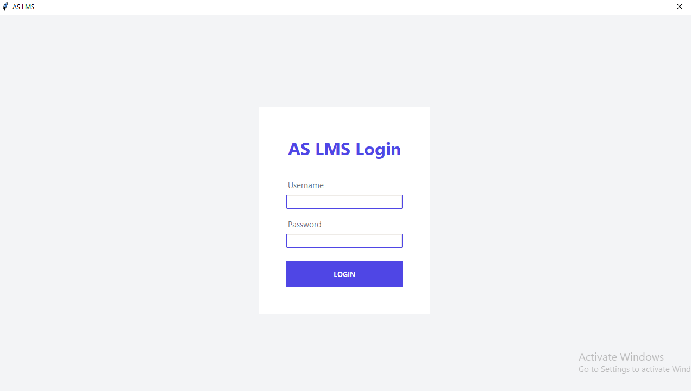
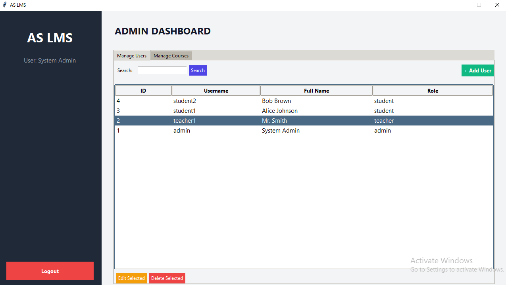
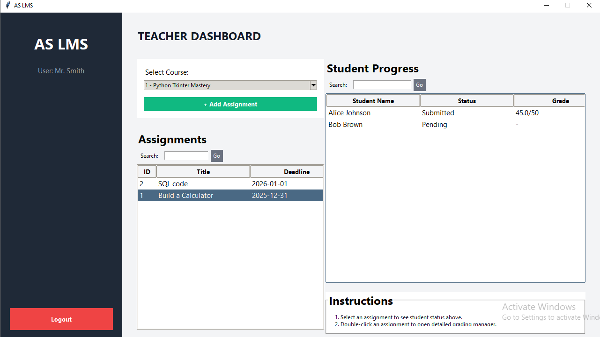
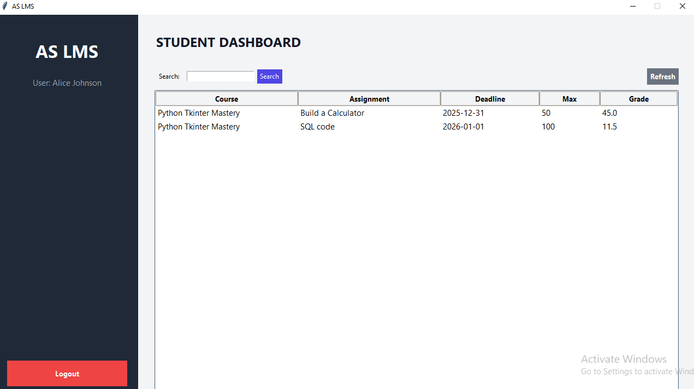

[🇬🇧 English](README.md) | [🇮🇷 فارسی](README.fa.md) | [🇸🇦 العربية](README.ar.md) | [🇨🇳 简体中文](README.zh-CN.md)

---
# AS-LMS — نظام إدارة التعلّم

**AS-LMS** هو تطبيق مكتبي لإدارة العمليات التعليمية، تم تطويره باستخدام Python وواجهة Tkinter الرسومية وقاعدة بيانات MySQL.

يوفّر التطبيق واجهات منفصلة للمسؤولين والمعلمين والطلاب، مع وظائف لإدارة المستخدمين والمقررات والواجبات والتسليمات والدرجات والملاحظات التعليمية.

## الميزات

### مسؤول النظام
- إدارة حسابات المستخدمين وأدوارهم.
- إدارة المقررات التعليمية.
- إدارة تسجيل الطلاب في المقررات.
- إدارة العلاقات الإرشادية بين الطلاب والمعلمين.

### المعلم
- الوصول إلى واجهة المعلم.
- إدارة واجبات المقررات.
- تحديد وصف الواجب والدرجة القصوى والموعد النهائي.
- مراجعة تسليمات الطلاب.
- تسجيل الدرجات وتقديم الملاحظات التعليمية.

### الطالب
- الاطلاع على المقررات المسجل فيها والواجبات المخصصة له.
- عرض تفاصيل الواجبات والمواعيد النهائية.
- إرسال إجابات الواجبات أو محتواها.
- الاطلاع على الدرجات وملاحظات المعلمين.

## التقنيات المستخدمة

- **لغة البرمجة:** Python
- **الواجهة الرسومية:** Tkinter وttk
- **قاعدة البيانات:** MySQL
- **موصل قاعدة البيانات:** MySQL Connector/Python
- **تجزئة كلمات المرور:** SHA-256

## المتطلبات

- Windows 10 أو Windows 11
- Python 3.10 أو إصدار متوافق
- MySQL Server
- pip

## هيكل المشروع

```text
AS-LMS/
├── main.py
├── view.py
├── controller.py
├── model.py
├── style.py
├── requirements.txt
├── .gitignore
├── .env.example
├── help.txt
├── database/
│   ├── schema.sql
│   └── seed.sql
└── README.md
```

قد تختلف الملفات الموجودة في المستودع الفعلي قليلًا عن هذا المثال.

## التثبيت والإعداد

### 1. تنزيل المشروع

استنسخ المستودع باستخدام الأوامر التالية:

```bash
git clone https://github.com/ArshamScode/AS-LMS.git
cd AS-LMS
```

يمكنك أيضًا اختيار **Code → Download ZIP** من GitHub ثم استخراج الملف المضغوط.

### 2. إنشاء بيئة افتراضية

```bash
python -m venv .venv
```

تفعيل البيئة الافتراضية على Windows:

```bash
.venv\Scripts\activate
```

### 3. تثبيت الاعتماديات

```bash
pip install -r requirements.txt
```

### 4. إعداد اتصال MySQL

تأكد من تثبيت MySQL Server وتشغيله.

راجع إعدادات اتصال قاعدة البيانات التي يستخدمها التطبيق، والتي توجد عادةً في `model.py`. اضبط المضيف والمنفذ واسم المستخدم وكلمة المرور واسم قاعدة البيانات بما يتوافق مع إعداد MySQL المحلي لديك.

لا تنشر كلمات المرور الحقيقية أو بيانات الاتصال السرية في مستودع عام.

### 5. إنشاء جداول قاعدة البيانات

افتح MySQL Workbench أو أي عميل MySQL مناسب، ثم نفّذ الملف:

```text
database/schema.sql
```

ينشئ هذا الملف قاعدة البيانات والجداول التي يحتاج إليها التطبيق، ولا يتضمن أمرًا مقصودًا لحذف قاعدة بيانات موجودة.

### 6. إضافة البيانات التجريبية

بعد إنشاء الجداول، نفّذ الملف التالي:

```text
database/seed.sql
```

يضيف هذا الملف حسابات تجريبية ومقررًا تعليميًا وعمليات تسجيل وواجبًا تجريبيًا.

يُفضّل تنفيذ ملف البيانات التجريبية مرة واحدة فقط على قاعدة بيانات تجريبية جديدة، لأن تكرار التنفيذ قد يؤدي إلى أخطاء بسبب وجود سجلات مكررة.

### 7. تشغيل التطبيق

من مجلد المشروع الرئيسي، نفّذ:

```bash
python main.py
```

## بيانات تسجيل الدخول التجريبية

يمكنك استخدام الحسابات التالية بعد تنفيذ `database/seed.sql` بنجاح.

**كلمة المرور لجميع الحسابات التجريبية:** `password123`

| الدور | اسم المستخدم | كلمة المرور |
|---|---|---|
| مسؤول النظام | `admin` | `password123` |
| المعلم | `teacher1` | `password123` |
| الطالب | `student1` | `password123` |
| الطالب | `student2` | `password123` |

هذه الحسابات مخصصة للاختبار والعرض فقط. لا تستخدم كلمة المرور التجريبية لحسابات حقيقية أو بيانات حساسة.

## قاعدة البيانات

تتضمن قاعدة البيانات جداول لإدارة:

- المستخدمين والأدوار
- العلاقات الإرشادية بين المعلمين والطلاب
- المقررات والتسجيلات
- الواجبات وتوزيعها على الطلاب
- تسليمات الطلاب
- الدرجات والملاحظات

تتوفر ملفات SQL بشكل منفصل لتسهيل إنشاء بنية قاعدة البيانات وإضافة البيانات التجريبية عند الحاجة.

## ملاحظات أمنية

- تستخدم الحسابات التجريبية كلمة مرور مشتركة مخصصة للاختبار.
- يستخدم الإصدار الحالي من المشروع SHA-256 لتجزئة كلمات المرور. يُنصح في الأنظمة الإنتاجية باستخدام خوارزمية مخصصة لتخزين كلمات المرور بأمان، مثل Argon2id أو scrypt أو bcrypt، مع إعدادات مناسبة.
- اضبط بيانات اتصال MySQL محليًا.
- لا ترفع كلمات المرور الحقيقية أو مفاتيح API أو ملفات الإعدادات السرية أو بيانات المستخدمين الحساسة إلى مستودع عام.
- راجع المشروع واختبره قبل استخدامه مع مستخدمين حقيقيين أو بيانات إنتاجية.

## استكشاف الأخطاء وإصلاحها

**خطأ في الاتصال بـ MySQL**
- تأكد من تشغيل MySQL Server.
- تحقق من المضيف والمنفذ واسم المستخدم وكلمة المرور.
- تأكد من إنشاء قاعدة البيانات بنجاح.

**وحدة Python غير موجودة**
- فعّل البيئة الافتراضية.
- أعد تنفيذ `pip install -r requirements.txt`.

**فشل تسجيل الدخول بالحساب التجريبي**
- تأكد من تنفيذ `database/seed.sql` بنجاح.
- تحقق من أن التطبيق وملف البيانات التجريبية يستخدمان قاعدة البيانات نفسها.
- تأكد من توافق طريقة تجزئة كلمة المرور مع القيمة المخزنة في قاعدة البيانات.

## هدف المشروع

يهدف AS-LMS إلى عرض إمكانات تطوير تطبيقات سطح المكتب باستخدام Python، وبناء واجهات رسومية، والاتصال بقواعد بيانات MySQL، وتطبيق واجهات مختلفة حسب دور المستخدم، وتنفيذ مهام شائعة في إدارة التعلّم.

## المطوّر

**Arsham Sarmast**

GitHub: [@ArshamScode](https://github.com/ArshamScode)

## الترخيص

لم يتم تحديد ترخيص لهذا المستودع حتى الآن. إلى أن تتم إضافة ترخيص واضح، لا ينبغي افتراض أن إعادة توزيع المشروع أو تعديله أو استخدامه تجاريًا مسموح به.

---

إذا وجدت المشروع مفيدًا، يمكنك إضافة نجمة إلى المستودع على GitHub.


---

## لقطات شاشة التطبيق

### شاشة تسجيل الدخول



### لوحة تحكم المسؤول



### لوحة تحكم المعلم



### لوحة تحكم الطالب




## الترخيص

هذا المشروع منشور بموجب ترخيص MIT. للاطلاع على الشروط الكاملة للاستخدام والتعديل وإعادة التوزيع، يرجى قراءة ملف [LICENSE](LICENSE).
